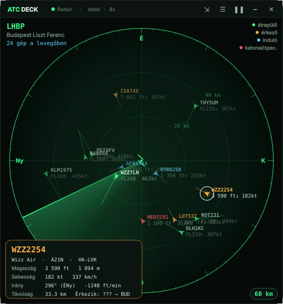
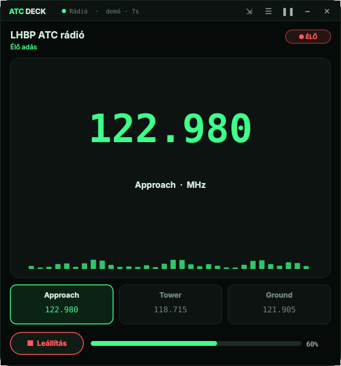
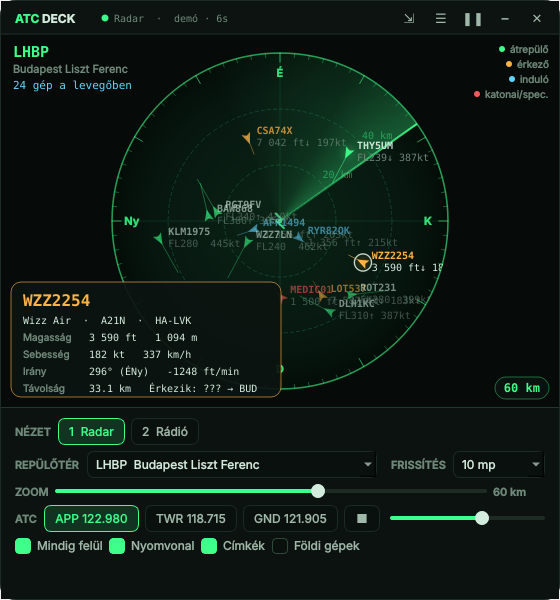
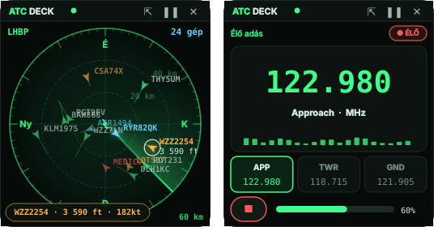

<div align="center">



# ATC Deck

**Élő repülőgép-radar és LHBP ATC rádió egy lebegő Windows-ablakban.**


</div>

Az ATC Deck a [ROBI-esp32](https://github.com/zoltan-234/ROBI-esp32) projekt radarjának asztali változata. Egy zöld, forgó pásztázós radaron mutatja a környék repülőit, mellette pedig élőben szól a budapesti légiforgalmi irányítás. Mindig a többi ablak fölött marad, de kompakt módban a sarokba húzva sem zavar.

> 📄 **Útmutató PDF:** az [ATC_Deck_utmutato.pdf](ATC_Deck_utmutato.pdf) 3 oldalon, képekkel mutatja be a telepítést, a funkciókat és a működést. Azt is leírja, pontosan mit telepít és mit használ a program a gépen, és hogyan lehet eltávolítani.

## Funkciók

**Radar**
- Forgó pásztázó csík, a gépek felvillannak, amikor átsöpör rajtuk
- Görgővel zoomolható, 3 és 400 km között
- A gépek a frissítések között is simán mozognak (sebesség és irány alapján)
- Nyomvonal és egyperces előrejelző vonal
- Kattintásra adatlap: légitársaság, típus, lajstrom, magasság, sebesség, irány, emelkedés
- Színkódok: zöld = átrepülő, narancs = érkező, kék = induló, piros = katonai vagy speciális (rendőr- és mentőhelikopter)
- Választható középpont: Budapest, Szeged, Debrecen, Győr, Hévíz, Pécs, Bécs, Pozsony

**ATC rádió**
- LHBP Approach 122.980, Tower 118.715 és Ground 121.905, élő LiveATC streamről
- Ha a kapcsolat megszakad, magától újracsatlakozik, és öt csatlakozási módot is végigpróbál

**Ablak**
- Mindig felül van, keret nélküli, húzható és átméretezhető
- Kompakt mód, kis méretben
- Előhúzható alsó vezérlőpult
- Tálcaikon, szünet gomb, és kilépéskor menti a beállításokat

## Képernyőképek

| Rádió | Vezérlőpult |
|:---:|:---:|
|  |  |

**Kompakt mód**



## Telepítés

Kell hozzá **Python 3.10 vagy újabb** ([python.org](https://www.python.org/downloads/) vagy Microsoft Store).

1. Töltsd le a repót (**Code → Download ZIP**), majd csomagold ki, vagy klónozd:
   ```
   git clone https://github.com/zoltan-234/ATC-Deck.git
   ```
2. Futtasd a **`Telepites.bat`** fájlt. Ez feltelepíti a csomagokat, és létrehozza az **ATC Deck** parancsikont az asztalon és a Start menüben.
3. Indítsd a parancsikonnal.

Kézzel is telepítheted:

```
pip install -r requirements.txt
python atc_deck.py --parancsikon
```

| Fájl | Mire való |
|---|---|
| `Telepites.bat` | csomagok telepítése és parancsikon |
| `Eltavolitas.bat` | parancsikonok és beállítások törlése, kérésre a csomagoké is |
| `Parancsikon.bat` | csak a parancsikon újbóli létrehozása (pl. a mappa áthelyezése után) |
| `ATC_Deck_inditas.bat` | indítás parancsikon nélkül |
| `ATC_Deck_demo.bat` | demó mód internet nélkül, kitalált forgalommal |
| `ATC_Deck_utmutato.pdf` | rövid útmutató: telepítés, funkciók, működés, mit használ a gépen |

## Használat

| Billentyű / egér | Funkció |
|---|---|
| `P` / `F2` / ☰ | vezérlőpult |
| `C` / ⇲ / dupla katt a felső sávra | kompakt mód |
| `1` / `2` | radar / rádió |
| `Space` | szünet |
| görgő, `+` / `-` | zoom (radar), hangerő (rádió) |
| kattintás egy gépre | adatlap |
| `H` | elrejtés a tálcára |
| `Esc` | vezérlőpult bezárása |

A tálcaikonra kattintva az ablak megjelenik vagy eltűnik, jobb klikkre menü nyílik.

## Mit telepít és mit használ a gépen?

| Tétel | Részletek |
|---|---|
| Python csomagok | `PySide6` (Qt grafikus keretrendszer, kb. 500–700 MB) és `miniaudio` (MP3 lejátszás, kb. 2 MB); a felhasználó saját Python-könyvtárába kerülnek |
| Parancsikonok | `ATC Deck.lnk` az asztalon és a Start menüben |
| Beállítások | `beallitasok.ini` az app mappájában; a registrybe nem ír |
| Hálózat | csak kimenő kérések: `api.adsb.lol`, `api.airplanes.live`, `*.liveatc.net` |

Nem indul el magától a Windows-zal, nem fut háttérszolgáltatásként, és nem kér rendszergazdai jogot.

## Eltávolítás

Futtasd az **`Eltavolitas.bat`** fájlt. Leállítja a futó programot, törli a parancsikonokat és a beállításokat, és megkérdezi, hogy a Python csomagokat is eltávolítsa-e. Végül a mappát kézzel töröld.

## Adatforrások

- **Repülőadatok:** [adsb.lol](https://adsb.lol), tartalékként [airplanes.live](https://airplanes.live). Mindkettő ingyenes, nem kell hozzájuk fiók vagy API-kulcs.
- **ATC hang:** [LiveATC.net](https://www.liveatc.net) streamek. Csak személyes hallgatásra; a streamek a LiveATC tulajdonai, és a felhasználási feltételeik vonatkoznak rájuk.

A megjelenített adatok tájékoztató jellegűek, navigációra nem használhatók.

## Felépítés

Az egész egyetlen Python fájl (`atc_deck.py`):

| Rész | Feladat |
|---|---|
| `DataStore` | ADS-B adatok lekérése és összefésülése, demó forgalom |
| `Radio` | stream letöltése, MP3 dekódolás (`miniaudio`), újracsatlakozás |
| `RadarView` / `RadioView` | a két nézet kirajzolása (QPainter, 60 fps) |
| `ControlPanel` | alsó vezérlőpult |
| `RadarWindow` | ablak, tálca, kompakt mód, beállítások mentése |

## Licenc

[MIT](LICENSE) © Szekeres Zoltán
